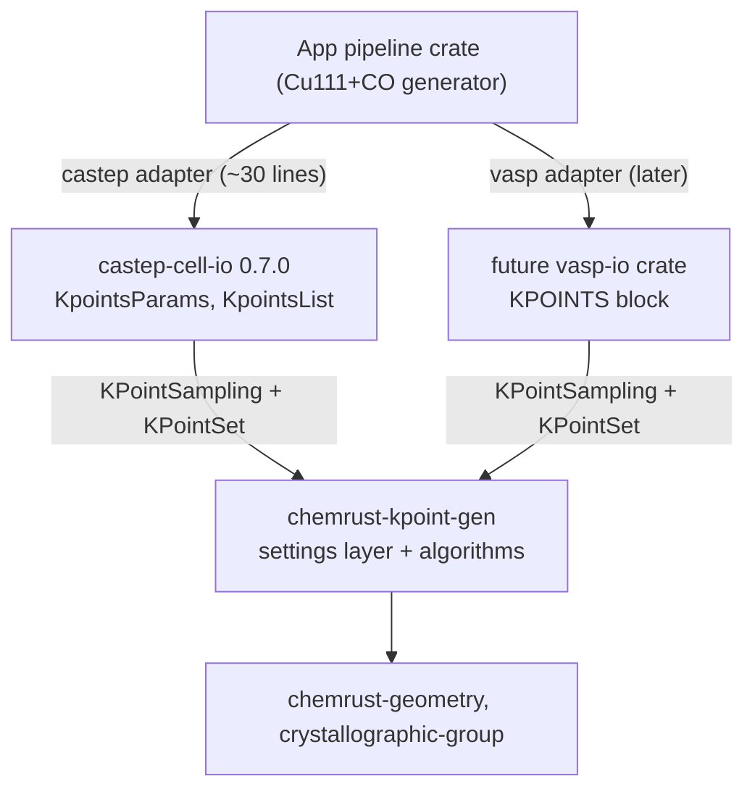

# K-Point Settings Layer

Approved 2026-10-18. This plan adds a code-agnostic k-point settings layer
to `chemrust-kpoint-gen` and a CASTEP app-adapter crate
`castep-kpoint-gen` (sibling of `castep-cell-io`, at
`~/programming/castep-kpoint-gen`).

## Layering

`castep-kpoint-gen` is the CASTEP app-adapter. It bridges the two crates
and owns CASTEP-specific conventions. kpoint-gen stays code-agnostic.
VASP support later is one adapter plus one enum variant. kpoint-gen gains
zero code dependencies.

## Decisions

| # | Question | Decision |
|---|---|---|
| D1 | Settings layer location | `settings` module in kpoint-gen. Not in castep-cell-io. |
| D2 | CASTEP adapter location | New standalone crate `castep-kpoint-gen` at `~/programming`. App crate now; promote to a published crate when a second consumer appears. |
| D3 | kpoint-gen depending on castep-cell-io | No dependency at all. |
| D4 | Weight convention | Normalize to 1. Property of the CASTEP adapter. |
| D5 | Symmetry source | Space-group number (value of the CASTEP `SYMMETRY` keyword, programmatic) or the `SYMMETRY_OPS` block. castep-cell-io has no space-group-number type. |

## kpoint-gen public API

Eight items, re-exported at the crate root. Modules stay private.

- `KPoint` - coordinates in (-1, 1)
- `IrreducibleKpt` - k-point + degeneracy
- `MPGrid`, `MPSpacingParam` - MP grid builders
- `SymmetryOperation` - trait; `SeitzMatrix` implements it
- `reduce_kpoints` - symmetry reduction
- `KPointSampling` - `Mp { grid, shift }` | `Spacing { spacing, shift }` | `Explicit { points, weights }`
- `KPointSet` - points + relative weights; `expand(reciprocal)` and `reduce(reciprocal, group)`

`KPointSampling::reduce` returns a `KPointSet` whose weights are the
normalized degeneracies. `apply_rotation_to_kpt` is `pub(crate)` and
`is_irreducible` is private.

## CASTEP adapter API (castep-kpoint-gen)

- `sampling_from_kpoints_params(&KpointsParams) -> Result<KPointSampling, Error>`
- `kpoints_params_from_set(&KPointSet) -> KpointsParams` (KPOINT_LIST form)
- `reduced_set<T: SymmetryOperation>(&CellDocument, &[T]) -> Result<KPointSet, Error>`
- `symmetry_from_space_group_number(u32) -> Result<Vec<SeitzMatrix>, Error>`
- `symmetry_ops_from_block(&SymmetryOps) -> Vec<CastepSymmetryOp>`

`CastepSymmetryOp` wraps the foreign `SymmetryOp` type because the
`SymmetryOperation` trait cannot be implemented for it directly (orphan
rule).

## Conventions and traps

1. **Coord range.** `KPoint` holds (-1, 1). `KPOINT_LIST` expects [0, 1)
   BZ fractions. The adapter folds `c < 0` to `c + 1`.
2. **Weights.** `Kpoint.weight` must sum to 1. The adapter passes the
   normalized degeneracies through.
3. **Mutual exclusion.** `KpointsParams` holds at most one of
   list / mp_grid / mp_spacing. Writing a KPOINT_LIST means the MP
   settings are dropped, or `validate()` errors.
4. **2pi spacing convention.** `ReciprocalCellVectors` follows the 2pi
   convention. CASTEP `KPOINTS_MP_SPACING` is crystallographic 1/ang.
   The adapter scales by `2pi` after the unit conversion. Unit factors
   to 1/ang: Angstrom 1.0, NanoMeter 0.1, Bohr 0.529177, Meter 1e-10.
5. **MP offset.** The adapter treats `KpointsMpOffset` as BZ fractions
   and converts to the `MPGrid` shift with `offset_i * 2 * n_i` per
   axis. The CASTEP manual discourages using the origin shift. Verify
   against CASTEP behaviour before relying on it.
6. **hall_symbol off-by-one.** `SpaceGroupTable::hall_symbol` is
   zero-indexed. CASTEP space-group numbers start at 1. Table row is
   `number - 1`.
7. **Core position set.** `core_position_set()` returns one entry per
   group element of the general position, not a generating set.
   Verified counts: P 1 -> 1 op, C2/c (SG 20) -> 4 ops, Fm-3m
   (SG 225) -> 48 ops. `reduce_kpoints` needs the full group.
8. **Translations ignored.** `SymmetryOperation` carries rotations only.
   Exact for symmorphic groups, an approximation for non-symmorphic
   ones.
9. **Lattice units.** The adapter supports Angstrom or no unit. Other
   `LengthUnit` values error with `UnsupportedLengthUnit`.

## Open items

- Verify the KPOINT_MP_OFFSET unit assumption against CASTEP.
- Non-symmorphic translation handling.
- Lattice units beyond Angstrom.
- Publish `castep-kpoint-gen` when a second consumer appears.
- `castep-kpoint-gen` has no git repo yet.

## Verification

- `chemrust` workspace: 24 tests (16 geometry + 8 kpoint-gen), 0
  warnings, `cargo doc` lists exactly the 8 public items.
- `castep-kpoint-gen`: 17 tests across `adapter.rs`, `symmetry.rs`,
  `round_trip.rs`, including a KPOINT_LIST write-out and re-parse
  round trip.
